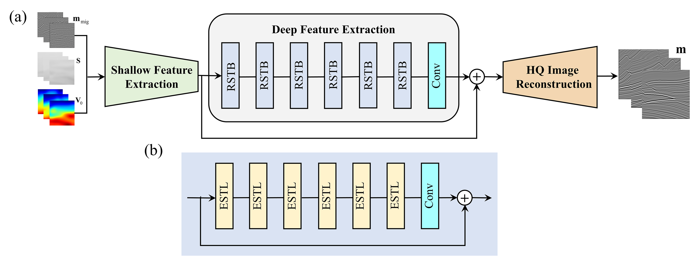
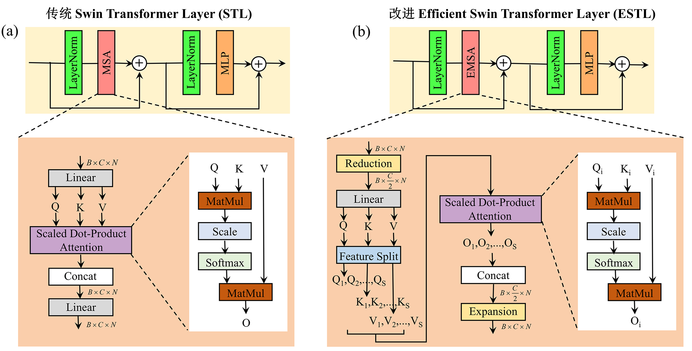
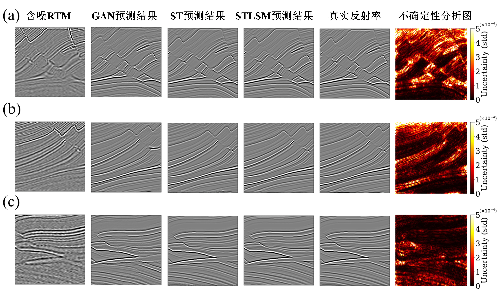
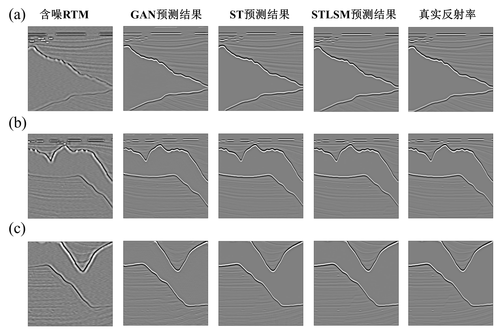

# STLSM: A Swin Transformer-Based Framework for Least-squares Seismic Imaging
This repository contains the official PyTorch implementation for the paper:
"STLSM: A Swin Transformer-Based Framework for Least-squares Seismic Imaging"
(Accepted by IEEE Transactions on Geoscience and Remote Sensing).

## Introduction

In this work, we propose a novel Swin Transformer-based framework (STLSM) for image-domain Least-squares Migration (LSM). We incorporate the migrated image, source illumination, and migration velocity model as inputs, and utilize an advanced Swin Transformer (ST) backbone to learn the mapping to true subsurface reflectivity. This framework is designed to achieve data-domain LSM-comparable imaging quality with significantly reduced memory consumption and computational costs.









## Environment Setup
We recommend using Anaconda to create a virtual environment.

```bash
conda create -n stlsm python=3.10
conda activate stlsm 
```

## Install PyTorch (Please adjust based on your CUDA version)
pip install torch torchvision torchaudio --index-url https://download.pytorch.org/whl/cu117


## Data Preparation
Our model requires three inputs: the initial migrated image, the source illumination map, and the migration velocity model.

Please organize your .mat dataset as follows and update the data paths in the options/train_msrresnet_psnr.json file:

text
```
datasets/
(1) training-set/
    LR/                 # Low-quality migrated images (Key: im_lq)
    illumination/       # Source illumination maps (Key: illumination)
    velocity/           # Migration velocity models (Key: velocity)
    HR/                 # High-quality true reflectivity (Key: im_gt)
(2) Validation-set/             # Same structure as train
(3) testing-set/                # Same structure as train
```
## Training
To train the STLSM framework from scratch, run:
```
python main_train_psnr_mat_3.py --opt options/train_msrresnet_psnr.json
```

## Testing
To test the trained model on your dataset, run:
```
python main_test_swinir_seismic_3input.py \
  --task classical_sr \
  --scale 2 \
  --training_patch_size 128 \
  --window_size 8 \
  --model_path path/to/your/model.pth \
  --folder_lq path/to/L \
  --folder_illumination path/to/illumination \
  --folder_velocity path/to/velocity \
  --folder_gt path/to/H \
  --save_dir path/to/Result
```

## Citation
If you find this code useful for your research, please cite our paper:

**GB/T 7714:**

```
W. Guo, J. Yang, et al., "STLSM: A Swin Transformer-Based Framework for Least-squares Seismic Imaging," in IEEE Transactions on Geoscience and Remote Sensing, 2026. (Accepted)
```

**BibTeX:**
```
bibtex
@article{guo2026stlsm,
  title={STLSM: A Swin Transformer-Based Framework for Least-squares Seismic Imaging},
  author={Guo, Wenjing and Yang, Jidong and others},
  journal={IEEE Transactions on Geoscience and Remote Sensing},
  year={2026},
  note={Accepted}
}
```
